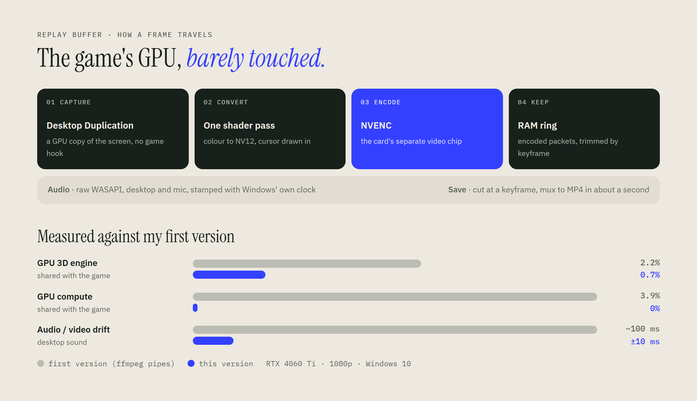

# Replay Buffer

**"Save the last 5 minutes" for Windows, built so the game you're playing doesn't notice.**
Written from scratch in Rust and C. Press Alt+F10 and the last few minutes of screen, desktop sound and mic become an MP4.



- **The whole video path stays on the GPU.** No ffmpeg runs while you play; it only runs for the second it takes to save.
- **Audio you can trust.** A built-in sync test measures how late desktop sound arrives (138 ms through Voicemeeter
  on my PC) and every clip corrects for it. Three tracks: mixed, desktop, mic.
- **Edits cleanly.** Fixed frame rate, so clips open in Premiere, DaVinci Resolve and CapCut. H.264, HEVC or AV1.
- **Research first.** The design follows a [written study](reports/Best%20replay%20buffer%20design.md) of how
  OBS, ShadowPlay, Steam and Medal capture and store video.

 &nbsp; 

<sub>The settings page is served by the app on `127.0.0.1` and only this PC can open it (Host check and a per-run token).</sub>

## What I ruled out

| Option | Why not |
|---|---|
| Windows.Graphics.Capture | Forces a yellow border on Windows 10 21H2 |
| NVIDIA NvFBC | Deprecated on Windows 10, not licensed for GeForce |
| Hooking the game | Ban risk under anti-cheat (Vanguard, Ricochet) |
| Piping frames to ffmpeg | My first version: extra copies and drifting audio |

## Build

Rust (MSVC), Visual Studio Build Tools, an NVIDIA GPU.

```bash
cargo build --release
```

Put `replay-buffer.exe` next to an `ffmpeg.exe` ([gyan.dev builds](https://www.gyan.dev/ffmpeg/builds/)) and run it.
`--test 20` records 20 s and prints stats; `--synctest` runs the sync measurement.

```
src/capture.rs    Desktop Duplication, shader, cursor, frame clock, NVENC
native/           nvenc_shim.c over NVIDIA's encoder API (nvEncodeAPI.h, MIT)
src/buffer.rs     RAM / SSD ring of encoded packets
src/audio.rs      WASAPI loopback and mic on the QPC clock
src/recorder.rs   runs and restarts the pipeline, saves clips
src/ui.rs         local settings page (ui.html)
```

Limits: NVIDIA only, one monitor, HDR is clipped to SDR.
