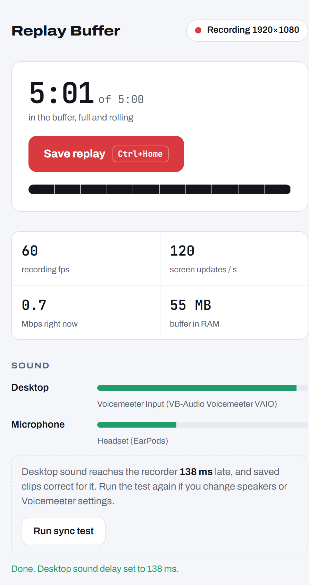
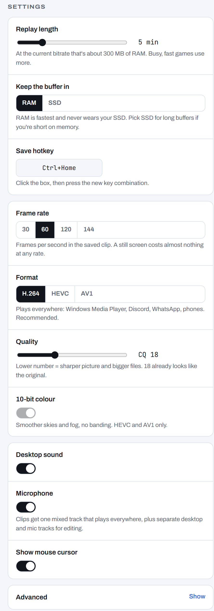

# Replay Buffer

**A ShadowPlay-style "save the last 5 minutes" recorder for Windows, written from scratch in Rust and C,
built so the game you are playing doesn't notice it.**

It keeps the last few minutes of your screen, desktop sound and mic in memory. Press a hotkey
(Alt+F10 by default) and those minutes become an MP4 in `Videos\Replays`.

<p>
  
  &nbsp;
  
</p>

### At a glance

- **Whole video pipeline on the GPU.** Windows Desktop Duplication → one HLSL shader pass → NVIDIA's
  hardware encoder (NVENC, called through a small C shim). No ffmpeg runs while you play.
- **3× lighter than my first version** on the GPU engine games use (0.7% vs 2.2%), and **0% vs 3.9%** on compute.
- **Audio in sync to about ±10 ms.** Built-in sync test measures how late desktop sound arrives
  (138 ms through Voicemeeter on my PC) and every saved clip corrects for it.
- **Research first.** The design came from a written study of how OBS, ShadowPlay, Steam and
  Medal capture, encode and store video ([report](reports/Best%20replay%20buffer%20design.md),
  [notes](research_notes/Best%20replay%20buffer%20design)). It also explains what was ruled out and why.
- **About 3,500 lines** of Rust plus the C encoder shim. The settings page is a local web page
  served by the app itself.

## What it does

- **Save replay:** hotkey or the tray icon. Clips go to `Videos\Replays`.
- **Settings page** at `http://127.0.0.1:47811` (from the tray). Shows the live buffer, fps,
  bitrate, audio meters and recent clips, and changes every setting without a restart. Only this
  PC can open it: it checks the Host header and every request needs a random per-run token.
- **Three audio tracks:** desktop + mic mixed (plays everywhere), then desktop and mic separately for editing.
- **Fixed frame rate**, so clips open cleanly in Premiere, DaVinci Resolve and CapCut.
- **H.264, HEVC or AV1**, 8-bit or 10-bit, buffer in RAM or on the SSD.

## How it works

```
Desktop Duplication (game's own format, no hidden conversion)
   │ one small shader pass: colour → NV12/P010 (BT.709), mouse cursor drawn in
   ▼
NVENC on the video chip, fixed frame rate (unchanged screen = repeat frame, nearly free)
   ▼
RAM (or SSD) ring of encoded packets, trimmed 2 s keyframe group at a time

WASAPI loopback + mic → raw samples stamped with Windows' own clock (QPC)

Save = cut at a keyframe, line audio up on the same clock, AAC-encode it,
       ffmpeg writes the MP4 (video copied, never re-encoded)
```

- **Nothing heavy runs while you play.** No ffmpeg process, no pipes. ffmpeg only runs for the second it takes to save.
- **The game goes first.** The recorder uses normal GPU priority, the process runs below normal, and nothing borrows
  the GPU's shader cores (no adaptive quantization, no NVENC colour conversion).
- **Audio never drops out.** Raw WASAPI with a silent keep-alive stream, so the timeline has no gaps when nothing is playing.

### Choices I ruled out

| Option | Why not |
|---|---|
| Windows.Graphics.Capture | Forces a yellow border around the screen on Windows 10 21H2 |
| NVIDIA NvFBC | Deprecated on Windows 10 and not licensed for GeForce cards |
| Hooking into the game | Ban risk under anti-cheat (Vanguard, Ricochet) |
| Piping frames to ffmpeg | My first version: extra copies, an extra process, audio and video clocks that drift |

## Measured on my PC (RTX 4060 Ti, 1080p, Windows 10 LTSC)

| | First version | This version |
|---|---|---|
| GPU 3D engine (shared with games) | 2.2% | 0.7% calm screen, up to ~3% with busy video |
| GPU compute (shared with games) | 3.9% | 0% |
| Video encoder chip (separate) | 21% (only changed frames) | ~36% (fixed 144 fps, preset P4) |
| Audio dropouts reported | constant | 0 |
| A/V sync, desktop sound | ~100 ms off, varied | about ±10 ms after the sync test |

Measured with Windows' GPU-engine performance counters, because a full-screen fps comparison on
a desktop with other apps open was too noisy to trust. Still to do: a real-game check with
PresentMon, recorder off vs on.

## Formats

| Format | Plays in Windows Media Player on LTSC | Notes |
|---|---|---|
| H.264 (default) | Yes | Plays everywhere: Discord, WhatsApp, phones |
| HEVC, 10-bit | No (needs VLC) | ~30% smaller |
| AV1, 10-bit | No (needs VLC or a browser) | Smallest |

## Build and run

Needs Rust (MSVC toolchain), the Visual Studio Build Tools and an NVIDIA GPU.

```bash
cargo build --release
```

Put `target\release\replay-buffer.exe` and an `ffmpeg.exe` (for example a build from
[gyan.dev](https://www.gyan.dev/ffmpeg/builds/)) in one folder and run it. A red dot appears in the tray.
The log is in `%APPDATA%\ReplayBuffer\log.txt` and settings in `config.toml` next to it.

Test switches:
- `replay-buffer.exe --test 20` records 20 s, saves, prints stats. Add `--flash` to flash + beep for a sync check.
- `replay-buffer.exe --synctest` runs the sync measurement.
- `RB_STAGE=dup` / `convert` turns off later stages to measure their cost.
- `cargo build --release --bin gpuload` builds a game-like GPU load that logs frame times:
  `gpuload.exe <secs> <iterations> <out.txt>`.

## Code map

```
src/main.rs       tray icon, hotkey, command-line test switches
src/capture.rs    Desktop Duplication, colour-conversion shader, cursor, fixed frame clock, NVENC
native/           nvenc_shim.c, a thin C layer over NVIDIA's encoder API
src/buffer.rs     the RAM / SSD ring of encoded packets, grouped by keyframe
src/audio.rs      WASAPI loopback and mic, QPC timestamps, keep-alive
src/recorder.rs   runs the pipeline, restarts it if anything breaks, saves clips
src/tsmux.rs      MPEG-TS writer used when saving HEVC
src/app.rs        state shared by the tray, hotkey and settings page
src/ui.rs         local settings server (+ ui.html)
src/selftest.rs   the flash-and-beep sync test
```

## Known limits

- NVIDIA GPUs only (NVENC).
- Records one monitor (the main one by default; change it under Advanced).
- HDR desktops are captured but clipped to SDR.

`native/nvEncodeAPI.h` is NVIDIA's header, MIT-licensed (notice inside the file).
